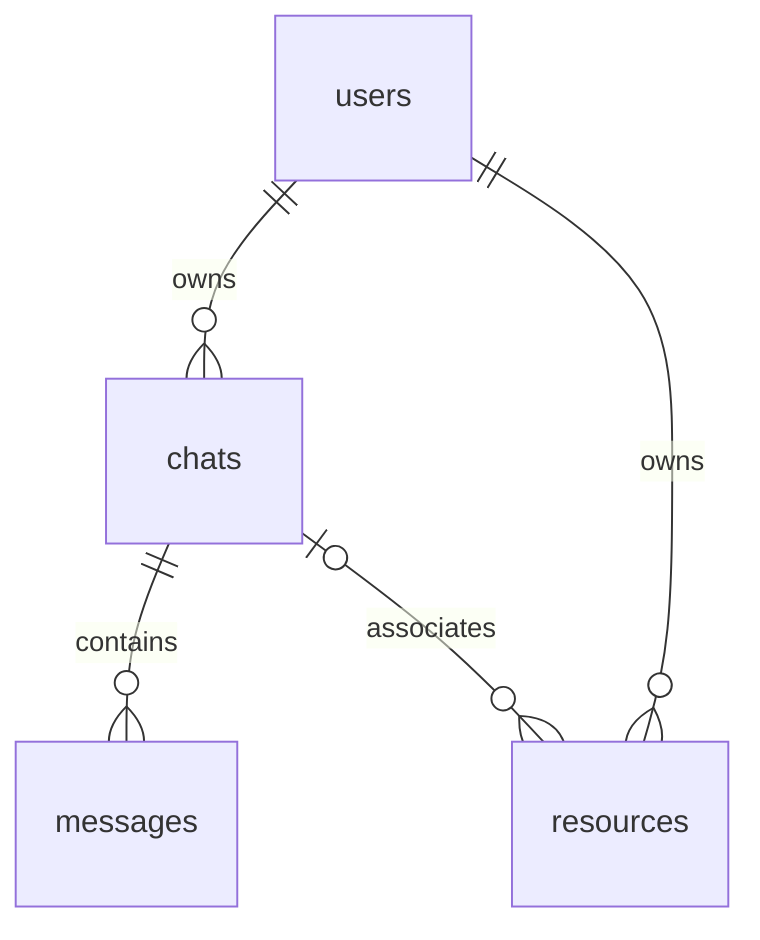

# PostgreSQL schema

This branch targets `main` (`e89a7b8`). Upstream has a request-translation notebook,
not a persistence-backed application. The notebook is unchanged and is not executed
by setup/tests. This supplies database structure and direct SQL usage, not an API,
cloud provisioner, authentication implementation or Terraform integration.

The four entities follow the supplied [UniCompute Screens design](https://docs.google.com/document/d/1cBThqL8UjR4khZ63OSPkdA6g4hwNWOE6OblTKGFJSVo/edit).



- UUID `id` is the internal identifier. Users have name/email and an issuer+subject
  unique identity (`auth_issuer`, `auth_provider_user_id`); email is not identity.
- Chats have owner, title and timestamps. Messages have chat, user/assistant role,
  content and creation time. Message ownership is inherited from its chat.
- Resources have owner, optional same-owner chat, name, provider, account/project
  scope, native type/ID, optional region, OS/CPU/memory/storage, status, approved
  configuration/time and timestamps. Provider identity is unique across
  `(provider, account_scope, region-or-global, native_type, provider_resource_id)`.
  Compute fields may be NULL for global/non-compute resources.
- Provider denotes the cloud, not an execution tool. No execution backend is present
  upstream, so no SDK/Terraform machinery or relationship framework is introduced.
- Foreign keys do not cascade deletion. `approved_config` accepts an object and is
  recorded with its approval time; it must contain sanitized configuration, never
  credentials or raw cloud plans/state. This is not a secret-detection system.
  Writers supply `updated_at` on changes. Status transitions and resource cleanup
  belong to the future application; the schema does not perform cloud operations.

## Setup and direct use

Requires Python 3.10+ and an **existing PostgreSQL 15+ database**. This code does not
provision a server or database. Install `psycopg[binary]>=3.3,<4` (also listed in
`requirements.txt`), set `DATABASE_URL` through your local environment, then run:

```sh
export DATABASE_URL=postgresql:///unitcompute
python -m database                 # apply migrations; repeated runs are safe
```

```python
from database import connect

with connect() as conn:            # commits on success; rolls back on exception
    user_id = conn.execute(
        "INSERT INTO users(auth_issuer, auth_provider_user_id, name) "
        "VALUES (%s, %s, %s) RETURNING id",
        ("https://your-issuer.example", "verified-subject", "Alice"),
    ).fetchone()[0]
```

Future application callers must verify identity and filter reads/writes by the
verified owner. Database ownership links are not a substitute for authorization.

Migrations are transactional and serialized per PostgreSQL schema. Applied checksums
and unknown versions are checked before new SQL runs. Append migrations instead of
editing applied files. Setup fails on conflicting existing tables; it never replaces
or clears them. This new schema is **not an upgrade path** from the separate experimental
Terraform/PostgreSQL feature branches. Preserve their data/history; reconciling any
real deployed schema requires a separate, explicit migration decision.

## Focused tests

Use an existing disposable PostgreSQL database and install `pytest>=8.3,<9`:

```sh
export TEST_DATABASE_URL=postgresql:///unitcompute_test
python -m pytest -q tests/test_database.py
```

Tests create uniquely named schemas and remove only those schemas. A missing database
fails the tests; there is no SQLite fallback or skipped integration suite. CI runs the
same tests against an official prebuilt PostgreSQL image, without image builds or cloud
access. Real API/persistence wiring awaits an actual application consumer on `main`.
